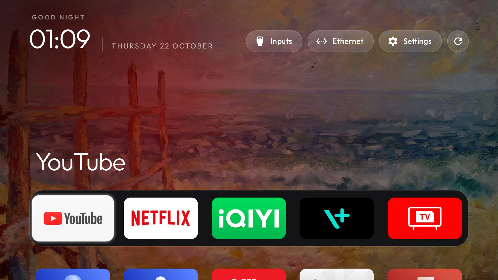
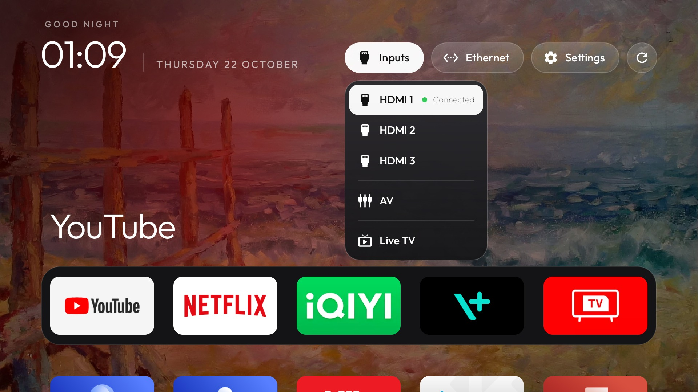
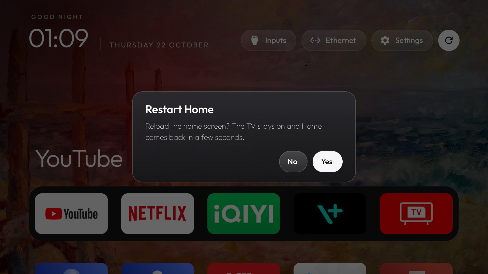

# tv-buddy

A small, fast home screen for a **TCL Smart TV Pro** running Android 11 on 2 GB of RAM.



Stock Google TV on this set is slow. It carries sponsored content rows, TCL's telemetry
wakes a foreground service roughly every 30 seconds, and the box sits with about 500 MB
swapped out at rest. This replaces the home screen with one that shows her apps, the
TV's inputs, a clock and a rotating wallpaper — and nothing else — then disables the
vendor services that were actually causing the lag.

Unrooted, nothing uninstalled, every change reversible.

## What it does

- **Dock and grid** — five pinned apps in a dock (YouTube, Netflix, iQIYI, Vision+,
  Live TV), the rest of her apps in a D-pad-navigable grid below.
- **Inputs menu** — HDMI 1–3, AV and **Live TV**, resolved through `TvInputManager`.
- **Quick pills** — Inputs, network status (with the SSID once granted), Settings, plus a
  restart button.
- **Restart Home** — reloads the launcher after a Yes/No confirmation. There is a real
  limitation here; see [Known limits](#known-limits).
- **Rotating wallpaper** — Google TV's own ambient artwork, mirrored off the set as it
  refreshes, shown sharp in 32-bit colour at 1:1.
- **Legibility scrim** — a soft vignette under the header so the greeting, clock and date
  stay readable over a busy painting.

### Screenshots

| Home | Inputs | Restart |
|---|---|---|
|  |  |  |

The partial row of tiles at the bottom edge is deliberate: the dock is pinned and the
grid continues underneath it.

## Target device

| | |
|---|---|
| Model | TCL Smart TV Pro / `BeyondTV4` / `G03_4K_GB` |
| SoC | Realtek `RTD2851M` (`rtd288o`), **Mali-G31**, GLES 3.2 |
| OS | Android **11**, API **30**, build `AR09` |
| RAM | 2 GB |
| ABI | `armeabi-v7a` only — no arm64 |
| Display | **1920×1080 @ 320 dpi** |
| Root | **No.** Locked bootloader, verified boot green, no `su` |

The panel is 4K, but the set's only supported display mode is 1920×1080 @ 60 Hz, so
everything — this launcher included — draws at 1080p and the TV scales. A 4K framebuffer
here would cost four times the pixels for an identical picture.

## Build

Needs JDK 17+ (tested on Temurin 21), Android SDK platform 34 and build-tools. No Gradle
install needed — the wrapper fetches it.

```bash
export JAVA_HOME=/path/to/jdk-21
export ANDROID_HOME=/path/to/android-sdk
cd launcher
./gradlew.bat assembleRelease      # ./gradlew on Linux/macOS
```

Output: `launcher/app/build/outputs/apk/release/app-release.apk` — about 408 KB, R8 with
`shrinkResources`.

Gate before shipping:

```bash
./gradlew.bat testReleaseUnitTest lintRelease
```

That is 126 unit tests and a clean lint report. The release build signs with the **debug
key** on purpose — it is sideloaded over adb and never published — so rebuilds install
straight over each other.

## Install

Deploy in this order. Do not skip to step 4.

```bash
ADB=adb
D="-s <TV_IP>:5555"

# 0. Wake first: the ambient screensaver takes over the screen when idle
"$ADB" $D shell input keyevent KEYCODE_WAKEUP

# 1. Install alongside the stock launcher, without touching HOME
"$ADB" $D install -r launcher/app/build/outputs/apk/release/app-release.apk

# 2. Launch it and look at it
"$ADB" $D shell am start -n com.gathin.tvhome/.MainActivity

# 3. Verify D-pad focus, the Inputs menu (Live TV present), and the app library.
#    Confirm HOME is still the stock launcher before continuing:
"$ADB" $D shell cmd package resolve-activity -a android.intent.action.MAIN \
  -c android.intent.category.HOME | grep packageName

# 4. Only once step 3 passes — switch HOME
"$ADB" $D shell cmd package set-home-activity com.gathin.tvhome/.MainActivity
```

Rollback at any time:

```bash
# back to Google TV
"$ADB" $D shell cmd package set-home-activity \
  com.google.android.apps.tv.launcherx/.home.HomeActivity

# or the AOSP TV safety net
"$ADB" $D shell cmd package set-home-activity \
  com.android.tv.settings/.system.FallbackHome
```

## Theme and wallpapers

The launcher reads a small theme directory **on the TV**, not from inside the APK:

```
/sdcard/Android/data/com.gathin.tvhome/files/
├── config.json
└── wallpapers/*.webp
```

Push the checked-in config plus whatever is in `theme/wallpapers/`:

```bash
ADB=adb sh tools/push-theme.sh <TV_IP>
```

### Following the ambient screensaver

Google refreshes the ambient artwork on its own schedule. `dreamx` downloads the pictures
into a `DiskLruCache` inside its own external data directory and rotates that set. The
launcher **cannot** read that directory — measured from the launcher's own uid:
`canRead=false` and a null listing *even holding `MANAGE_EXTERNAL_STORAGE`*, because
Android 11 seals `Android/data/<pkg>` per app. `adb shell` can read it, because `shell`
runs in the `sdcard_rw` group. So the copy happens from the host:

```bash
sh tools/sync-ambient.sh <TV_IP>          # picked up on the next rotation
sh tools/sync-ambient.sh <TV_IP> --now    # or restart Home straight away
```

Only new pictures are copied, and copies of pictures Google has retired are deleted, so
the rotation tracks the screensaver instead of growing forever. The copy runs on the TV
(`sh -s`), so no picture crosses the network. Schedule it if you want it automatic — the
launcher rescans its own collection on every rotation, so nothing needs restarting.

`tools/pull-ambient-art.sh` is the separate, one-off extractor for the ten pictures that
ship inside the `dreamx` APK itself.

### Why the pictures are sharp

Pictures decode at full resolution in 32-bit colour and are drawn 1:1 — no blur, no
colour reduction. Measured on the same wallpaper with the old decode-time blur on and
off: **10.5×** more high-frequency detail, identical brightness, 0.998 correlation (same
scene). It costs about 21 MB of PSS, which is the trade being made. The blur remains
available behind `wallpaper_soften` if a sharp photograph behind the glass panels turns
out too busy.

## Configuration

`launcher/app/src/main/res/values/config.xml` holds the defaults; `theme/config.json`
overrides them on the TV with no rebuild.

| `theme/config.json` key | Default | Meaning |
|---|---|---|
| `wallpaper_rotation_minutes` | `10` | Minutes per picture. **`0` disables rotation** — and the collection is not loaded at all |
| `wallpaper_dim` | `55` | Black overlay, 0–90%, for text contrast |
| `wallpaper_soften` | `false` | Pre-blur each picture once at decode time |
| `wallpaper_order` | `shuffle` | `shuffle` or `sequential` |
| `wallpaper_true_color` | `true` | 32-bit colour instead of RGB_565 |

Other `config.xml` values worth knowing: `dock_apps`, `columns`, `live_tv_package`,
`hidden_apps`, `rows_below_dock`, `app_banners`, `app_labels`, `sky_intensity`.

Rotation is checked once a minute against wall-clock time since the last change, so a
picture turns over at 10–11 minutes. Leaving Home pauses the player but not the clock:
come back after longer than the interval and it changes immediately.

## What was disabled

26 packages disabled with `pm disable-user --user 0` — nothing uninstalled, every one
reversible with `pm enable`. TCL's telemetry (`com.tcl.bi`), the update nag, the game bar,
the HEAR-aid setup app, Chromium's WebView shell, the print spooler, and others. Measured
effect: **+272 MB** available memory, swap **504 MB → 56 MB** at boot.

The full list, why each package was safe, and the ones deliberately kept are in
[`docs/DEBLOAT.md`](docs/DEBLOAT.md). `com.tcl.versionUpdateApp` stays enabled on purpose
so the set can still take firmware updates.

## Known limits

**HDMI 4 cannot be offered.** The hardware port exists
(`TvInputHardwareInfo{id=1413745664, type=9, hdmi_port=4}`) but TCL's `TIF_TvInput` never
registered a `TvInputInfo` for it — it appears only as hardware, never as an input. Ports
1–3 are registered. The stock Google TV launcher reads the same `TvInputManager` API and
cannot offer it either.

**A restart button cannot reboot the TV.** `android.permission.REBOOT` is
`signature|privileged`, so an APK install can never hold it; there is no root; and device
owner is ruled out by the accounts on the set. Both API routes were tried on the device:
`ACTION_REBOOT` is accepted and then silently does nothing, and `PowerManager.reboot()`
throws `SecurityException`. So the button restarts **Home** — killing the launcher so the
system starts it again — and the dialog says exactly that. A full restart remains
long-press power on the remote.

**No real Liquid Glass.** Backdrop sampling needs `RuntimeShader` (API 33) or
`RenderEffect` (API 31); this TV is API 30. The panels are glassmorphism — gradients and
a rim highlight — with any blur done once at decode rather than per frame, which is zero
per-frame GPU cost on a Mali-G31.

**The launcher alone would not have fixed the lag.** Measured PSS: ~41–63 MB here against
87 MB for `launcherx` plus ~34 MB of `:coreservices`, so about 76 MB saved. The rest came
from disabling TCL's background services; `com.tcl.bi` alone woke a foreground service
roughly every 30 seconds.

**`logcat` is empty on this set.** `logcat -d` returns zero lines, so `Log.*` is useless
for diagnosis here. Status files were used instead.

## Docs

- [`docs/RECON-LEDGER.md`](docs/RECON-LEDGER.md) — every measured fact about the device, evidence-tagged
- [`docs/DECISIONS.md`](docs/DECISIONS.md) — kickoff decisions, findings and verification log
- [`docs/DEBLOAT.md`](docs/DEBLOAT.md) — the package triage: safe / caution / danger
- [`docs/OPTIMIZE.md`](docs/OPTIMIZE.md) — remaining optimisation options, ranked by RES
- [`docs/AUDIT.md`](docs/AUDIT.md) — two audit passes: what was found, fixed, and missed the first time

## Credits

**Built on**

- [**cleanyourtv**](https://github.com/Gathin23/cleanyourtv) by Gathin — the launcher this
  is vendored from. MIT, © 2026 Gathin; full text in
  [`licenses/cleanyourtv-MIT.txt`](licenses/cleanyourtv-MIT.txt). Pinned at commit
  `3e996739ce0b470b51c1c438bf5d0559d1c9e7eb`; only its `launcher/` directory is vendored
  here.
- **Outfit** typeface — SIL Open Font License, in
  [`launcher/FONT-LICENSE-OFL.txt`](launcher/FONT-LICENSE-OFL.txt).
- **Material Icons** — Apache 2.0, Google. The restart arrow (`ic_restart`) comes from it;
  the remaining icons come from the upstream project.

**Artwork**

- The wallpapers are **Google TV's ambient artwork**, extracted from the `dreamx` package
  that already ships on the set. They are Google's, and this repository does not
  redistribute them: `theme/wallpapers/*.webp` is gitignored and the sync scripts copy
  them off the device at runtime. For a clean-room build, bring your own pictures — any
  `.webp`, `.jpg` or `.png` dropped in the collection rotates.

**Read and evaluated, not used**

- [**tv-detox**](https://github.com/Ansub/tv-detox) — read for comparison while choosing a
  base; not used.
- [**QmDeve/AndroidLiquidGlassView**](https://github.com/QmDeve/AndroidLiquidGlassView) —
  evaluated for the glass panels; it renders nothing below Android 13, so it cannot work
  on this set.
- [**lesnolie/Tigris**](https://github.com/lesnolie/Tigris) — referenced for the
  pre-blurred-wallpaper trade-off on TV-class hardware.

**Tooling**

- Android SDK build-tools and platform-tools, the Gradle wrapper, and AndroidX
  RecyclerView.
- [**scrcpy**](https://github.com/Genymobile/scrcpy) (Genymobile, Apache 2.0) — screen
  mirroring while developing against a TV in another room.
- [**grill-me**](https://github.com/RobMitt/grill-me-skill) — the kickoff interview used
  before any code was written.

## License

The vendored launcher is MIT, as above. Treat the stock Google TV launcher strictly as a
read-only oracle: no compiled code from it was copied into this project, and none of
TCL's or Google's proprietary binaries are redistributed here.
